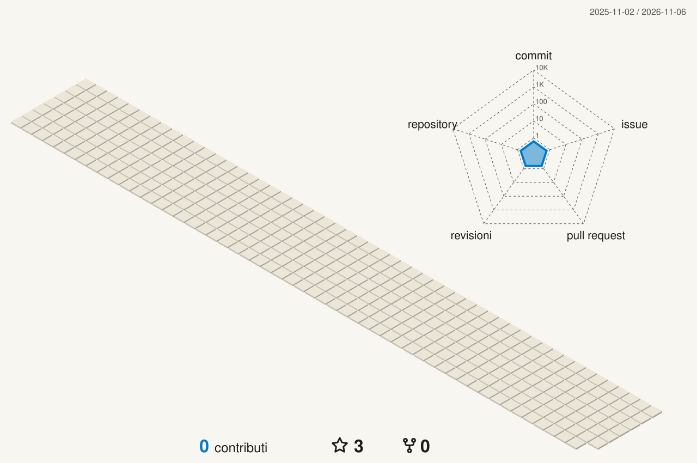

<!--
  Questo README si rifà da solo: la Action «profilo» lancia profilo/genera.mjs ogni
  15 minuti e riscrive le parti fra i segni «nome:inizio» e «nome:fine». Tutto il
  resto si scrive a mano, e il generatore non lo tocca.
-->

<!-- testa:inizio -->
<a href="https://www.albertopecchini.it"><picture><source media="(prefers-color-scheme: dark)" srcset="https://cdn.jsdelivr.net/gh/ygpzk/ygpzk@cd29d3103532/immagini/testa-scuro.svg"></picture></a>
<!-- testa:fine -->

<!-- tasti:inizio -->
<p align="center">
  <a href="https://www.albertopecchini.it"><picture><source media="(prefers-color-scheme: dark)" srcset="immagini/tasto-sito-scuro.svg?v=b3bf6bb1"></picture></a>
  <a href="https://www.pzkko.it"><picture><source media="(prefers-color-scheme: dark)" srcset="immagini/tasto-pzkko-scuro.svg?v=8a840ca0"></picture></a>
  <a href="https://www.pzkko.it/wiki/"><picture><source media="(prefers-color-scheme: dark)" srcset="immagini/tasto-wiki-scuro.svg?v=57bd31ad"></picture></a>
  <a href="mailto:pzkko@yahoo.com"><picture><source media="(prefers-color-scheme: dark)" srcset="immagini/tasto-scrivimi-scuro.svg?v=c9794fed"></picture></a>
</p>
<!-- tasti:fine -->

<br>

### ciao, sono alberto.

diplomato geometra a rivalta sul mincio, in provincia di mantova: rilevo e disegno edifici, scrivo siti web a mano, costruisco marchi. lo stesso metodo, la stessa cura.

qui c’è tutto il codice dei miei siti, dalla prima bozza alla produzione: html, css e javascript senza framework, build con vite, immagini preparate da script, un server in casa per i dati e github actions che rifotografano i siti ogni ora. lo scrivo insieme a [claude code](https://claude.com/claude-code), un commit alla volta — e qui sotto, aggiornato da solo, c’è l’ultima cosa che ho cambiato.

<br>

## ✦ cosa ho cambiato per ultimo

<sub>i due commit più recenti, da tutti i repository e da tutti i rami. si leggono così: <code>!</code> modificato · <code>+</code> aggiunto · <code>−</code> rimosso.</sub>

<!-- commit:inizio -->
### ①&nbsp; pzkkopedia allineata al biglietto dell'ospite (d6ff9ab)

📝 **documenti** in `wiki` · [AP](https://github.com/ygpzk/AP) su `main` · 6 nov 2026, 12:34 · [`e168cea`](https://github.com/ygpzk/AP/commit/e168cea2b6ee35156ce2d72d1ac8aa8328d481b9)

> **i file:** <b>3</b> modificati &nbsp;·&nbsp; **le righe:** <b>+10</b> in più, <b>−10</b> in meno

```diff
@@ albertopecchini.it/pzkko/wiki/ @@
! cronologia.js  +3 −3
! stato.json  +3 −3
! voci/dati.js  +4 −4
```

### ②&nbsp; l'ospite appena arrivato aspetta il biglietto della banca prima di ogni azione (niente più 401 a ogni visita nuova)

🔧 **riparazione** in `pzkko` · [AP](https://github.com/ygpzk/AP) su `main` · 6 nov 2026, 12:34 · [`d6ff9ab`](https://github.com/ygpzk/AP/commit/d6ff9abbaaea3fe685af7bfedbaec946d84e2d1c)

Trovato dal bot dei bug sul sito vero: chi arriva senza conto faceva partire sfide.oggi e virtual.palinsesto con «ospite: null» prima che la banca gli desse il biglietto, e /api/wallet/ rispondeva 401 «entra di nuovo». In games/pzk.js il biglietto si chiede una volta sola (primoBiglietto) e ogni fai lo aspetta; se…

> **i file:** <b>4</b> modificati &nbsp;·&nbsp; **le righe:** <b>+21</b> in più, <b>−6</b> in meno

```diff
@@ albertopecchini.it/ @@
! pzkko/chat/sfide.js  +0 −3
! pzkko/games/pzk.js  +14 −1
! pzkko/wiki/voci/dietro.js  +1 −1
! tools/pzkko/bot/bot.mjs  +6 −1
```
<!-- commit:fine -->

<br>

## ✦ novità

<!-- novita:inizio -->
**negli ultimi 7 giorni** 62 commit, soprattutto su `pzkko` (14), `tempo` (14), `wiki` (5), `esperimenti` (5).

- **6 nov** · **tools** — il bot dei bug di pzkko, che gira da solo a ogni push e due volte al giorno sul sito vero · [AP↗](https://github.com/ygpzk/AP/commit/541f48c30f3af574ade064e9d6b7e631dd1f0b91)
- **6 nov** · **tools** — il bot dei bug di pzkko, che gira da solo a ogni push e due volte al giorno sul sito vero · [AP↗](https://github.com/ygpzk/AP/commit/99f4342423d67aa70a54b1a8b0ab31369e4a6af4)
- **6 nov** · **pzkko** — il cartello della manutenzione sul muro della stazione di Monaco, e il sito chiuso fino a domenica alle 14 · [AP↗](https://github.com/ygpzk/AP/commit/7d95b08b368dfa2b692aa79267988a43db1db987)
- **5 nov** · **pzkko** — il file di verifica del dominio per Discord in /.well-known/discord · [AP↗](https://github.com/ygpzk/AP/commit/7032f2e453acd304cc0027492c5e5af668c9232c)
- **4 nov** · **lezioni** — la barra sta sul bordo destro del 24" ed esce dalla cattura · [AP↗](https://github.com/ygpzk/AP/commit/1f9a29281212c1dc9c593a056287a425e631551b)
- **4 nov** · **lezioni** — si registra sempre e solo lo schermo di Opera GX, e la barra parte aperta · [AP↗](https://github.com/ygpzk/AP/commit/3b6af0dcdd2f41c413aca419340b80e797fcc19a)
<!-- novita:fine -->

<br>

## ✦ in cantiere

<!-- cantiere:inizio -->
| progetto | cos’è | ultimo push |
|:--|:--|--:|
| **[albertopecchini.it](https://www.albertopecchini.it)**<br><sub>[ygpzk/AP](https://github.com/ygpzk/AP)</sub> | il portfolio, **pzkko.it** (il muro con i social, la scena 3D, i giochi, il cercapersone zero e la pzkkopedia) e la parodia **bettercallpekko.it**: siti statici scritti a mano, con Vite e niente framework | 6 nov 2026 |
| **[rivaltasulmincio.it](https://www.rivaltasulmincio.it)**<br><sub>[ygpzk/rivaltasulmincio](https://github.com/ygpzk/rivaltasulmincio)</sub> | il sito della Pro Loco di Rivalta sul Mincio: notizie, eventi, fotografie e il borgo nel Parco del Mincio | 3 nov 2026 |
| **[ing. dario donelli](https://dariodonelli.vercel.app)**<br><sub>[ygpzk/dariodonelli-](https://github.com/ygpzk/dariodonelli-)</sub> | lo studio di ingegneria di Dario Donelli | 9 ott 2026 |
| **[cascinafontana.xyz](https://www.cascinafontana.xyz)**<br><sub>[ygpzk/cascinafontana](https://github.com/ygpzk/cascinafontana)</sub> | la Società Agricola Cascina Fontana: i prodotti, la galleria e i contatti | 27 set 2026 |
| **[questo profilo](https://github.com/ygpzk)**<br><sub>[ygpzk/ygpzk](https://github.com/ygpzk/ygpzk)</sub> | il README che stai leggendo: si riscrive da solo, con le immagini disegnate nei caratteri del sito | 6 nov 2026 |
<!-- cantiere:fine -->

<br>

## ✦ i numeri

<!-- numeri:inizio -->
<picture><source media="(prefers-color-scheme: dark)" srcset="immagini/numeri-scuro.svg?v=3fadceb8"></picture>
<!-- numeri:fine -->

<picture>
  <source media="(prefers-color-scheme: dark)" srcset="profile-3d-contrib/3d-scuro.svg">
  
</picture>

<br>

## ✦ con cosa lavoro

<!-- nelle URL le virgole si scrivono %2C: GitHub taglia lo srcset del tema scuro alla prima virgola -->
<p>
  <picture>
    <source media="(prefers-color-scheme: dark)" srcset="https://skillicons.dev/icons?i=js%2Cts%2Chtml%2Ccss%2Cnodejs%2Cvite%2Cthreejs%2Cvercel%2Cgithubactions%2Cgit%2Cvscode%2Cfigma%2Cpy%2Cpowershell%2Ccloudflare&theme=dark&perline=15">
    
  </picture>
</p>

<sub>e poi claude code, sharp, ffmpeg, puppeteer, resend, lighthouse e un server di casa dietro tailscale funnel.</sub>

<br><br>

<picture>
  <source media="(prefers-color-scheme: dark)" srcset="immagini/serpente-scuro.svg">
  
</picture>

<p align="center">
  <!-- piede:inizio -->
<sub>ultimo commit letto: <a href="https://github.com/ygpzk/AP/commit/e168cea2b6ee35156ce2d72d1ac8aa8328d481b9"><code>e168cea</code></a> del 6 nov 2026, 12:34 · il profilo si rifà da solo ogni 15 minuti</sub>
<!-- piede:fine -->
  <br>
  <sub>fatto a mano da <a href="https://www.albertopecchini.it">Alberto Pecchini</a> · </sub>
</p>
