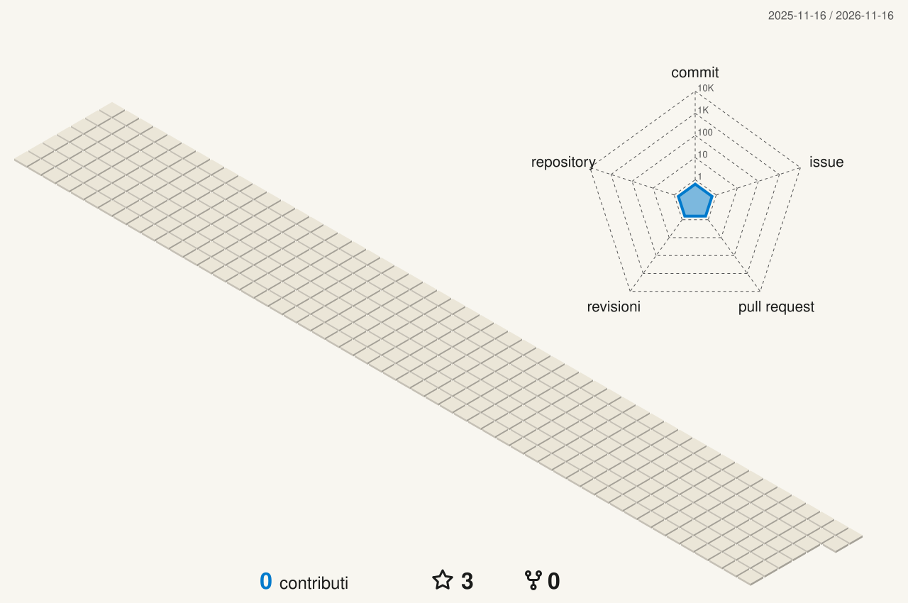

<!--
  Questo README si rifà da solo: la Action «profilo» lancia profilo/genera.mjs ogni
  15 minuti e riscrive le parti fra i segni «nome:inizio» e «nome:fine». Tutto il
  resto si scrive a mano, e il generatore non lo tocca.
-->

<!-- testa:inizio -->
<a href="https://www.albertopecchini.it"><picture><source media="(prefers-color-scheme: dark)" srcset="https://cdn.jsdelivr.net/gh/ygpzk/ygpzk@cd29d3103532/immagini/testa-scuro.svg"></picture></a>
<!-- testa:fine -->

<!-- tasti:inizio -->
<p align="center">
  <a href="https://www.albertopecchini.it"><picture><source media="(prefers-color-scheme: dark)" srcset="immagini/tasto-sito-scuro.svg?v=b3bf6bb1"></picture></a>
  <a href="https://www.pzkko.it"><picture><source media="(prefers-color-scheme: dark)" srcset="immagini/tasto-pzkko-scuro.svg?v=8a840ca0"></picture></a>
  <a href="https://www.pzkko.it/wiki/"><picture><source media="(prefers-color-scheme: dark)" srcset="immagini/tasto-wiki-scuro.svg?v=57bd31ad"></picture></a>
  <a href="mailto:pzkko@yahoo.com"><picture><source media="(prefers-color-scheme: dark)" srcset="immagini/tasto-scrivimi-scuro.svg?v=c9794fed"></picture></a>
</p>
<!-- tasti:fine -->

<br>

### ciao, sono alberto.

diplomato geometra a rivalta sul mincio, in provincia di mantova: rilevo e disegno edifici, scrivo siti web a mano, costruisco marchi. lo stesso metodo, la stessa cura.

qui c’è tutto il codice dei miei siti, dalla prima bozza alla produzione: html, css e javascript senza framework, build con vite, immagini preparate da script, un server in casa per i dati e github actions che rifotografano i siti ogni ora. lo scrivo insieme a [claude code](https://claude.com/claude-code), un commit alla volta — e qui sotto, aggiornato da solo, c’è l’ultima cosa che ho cambiato.

<br>

## ✦ cosa ho cambiato per ultimo

<sub>i due commit più recenti, da tutti i repository e da tutti i rami. si leggono così: <code>!</code> modificato · <code>+</code> aggiunto · <code>−</code> rimosso.</sub>

<!-- commit:inizio -->
### ①&nbsp; Deutschland 3, il tavolo dei ricordi, i tasti veri della macchinetta e i pacchetti che aprono il loro album

✨ **novità** in `deutschland` · [AP](https://github.com/ygpzk/AP) su `albertopecchini.it` · 10 nov 2026, 14:18 · [`c40dae8`](https://github.com/ygpzk/AP/commit/c40dae80e1d7122597795165a5614a9d80bece21)

- tavolo.js: le foto migliori sparse storte su un foglio di carta, i pacchetti in mezzo, le frasi di JMA e gli sticker - packung.js: l'album di un pacchetto in sovrapposizione (#p=\<tag\>) - accesso.js: la password si manda coi tasti 1–8 della macchinetta, il pacchetto cade dalla bocchetta - cinque calligrafie nuove…

> **i file:** <b>16</b> modificati + <b>7</b> aggiunti &nbsp;·&nbsp; **le righe:** <b>+1727</b> in più, <b>−917</b> in meno

```diff
@@ albertopecchini.it/ @@
! pzkko/deutschland/  (10 file modificati)
! pzkko/wiki/cronologia.js  +3 −3
! pzkko/wiki/stato.json  +3 −3
! pzkko/wiki/voci/dati.js  +459 −459
! pzkko/wiki/voci/deutschland.js  +82 −40
! tools/pzkko/deutschland/README.md  +5 −0
! tools/pzkko/deutschland/manifesto.mjs  +11 −0
+ pzkko/deutschland/packung.js  +119 −0
+ pzkko/deutschland/tavolo.js  +390 −0
+ pzkko/fonts/  (5 file aggiunti)
```

### ②&nbsp; pzkkopedia allineata a 51bfa22, la storia di Deutschland e i pacchetti delle persone pieni

📝 **documenti** in `wiki` · [AP](https://github.com/ygpzk/AP) su `albertopecchini.it` · 9 nov 2026, 22:57 · [`74c82a3`](https://github.com/ygpzk/AP/commit/74c82a3a3883c52d8f98ac05d03e006edd53f907)

> **i file:** <b>4</b> modificati &nbsp;·&nbsp; **le righe:** <b>+14</b> in più, <b>−14</b> in meno

```diff
@@ albertopecchini.it/pzkko/wiki/ @@
! cronologia.js  +3 −3
! stato.json  +3 −3
! voci/dati.js  +7 −7
! voci/deutschland.js  +1 −1
```
<!-- commit:fine -->

<br>

## ✦ novità

<!-- novita:inizio -->
**negli ultimi 7 giorni** 41 commit, soprattutto su `pzkko` (9), `wiki` (8), `tempo` (6), `esperimenti` (5).

- **10 nov** · **deutschland** — Deutschland 3, il tavolo dei ricordi, i tasti veri della macchinetta e i pacchetti che aprono il loro album · [AP↗](https://github.com/ygpzk/AP/commit/c40dae80e1d7122597795165a5614a9d80bece21)
- **9 nov** · **deutschland** — i nomi nell'album e la storia di Deutschland nella wiki · [AP↗](https://github.com/ygpzk/AP/commit/18971d76151dccdb1fb4b14837664f246d31eb61)
- **9 nov** · **pzkko** — Deutschland 2, l'album dei ricordi: foto su Backblaze B2, album a righe giustificate, mappa su carta, macchinetta e pacchetti rifatti · [AP↗](https://github.com/ygpzk/AP/commit/9470eb903bc3ed8bf8f878e8cdc56e1b66e0d10e)
- **9 nov** · **pzkko** — lo schermo della macchinetta con le dodici tappe vere, i posti spezzati riuniti · [AP↗](https://github.com/ygpzk/AP/commit/1f09869d12227a405bda5f9fe02210660d344cf1)
- **9 nov** · **pzkko** — la macchinetta delle sigarette sulla serranda e pzkko.it/deutschland, la galleria del viaggio a Monaco e Stoccarda con JMA · [AP↗](https://github.com/ygpzk/AP/commit/0a2e5e8ce77528ffc59653688d218c0127f50597)
- **9 nov** · **pzkko** — la saracinesca alleggerita, solo 2D (6.11) · [AP↗](https://github.com/ygpzk/AP/commit/39d41eb219a13a3d69bfb7ef70ca9b1fd81ccb6c)
<!-- novita:fine -->

<br>

## ✦ in cantiere

<!-- cantiere:inizio -->
| progetto | cos’è | ultimo push |
|:--|:--|--:|
| **[albertopecchini.it](https://www.albertopecchini.it)**<br><sub>[ygpzk/AP](https://github.com/ygpzk/AP)</sub> | il portfolio, **pzkko.it** (il muro con i social, la scena 3D, i giochi, il cercapersone zero e la pzkkopedia) e la parodia **bettercallpekko.it**: siti statici scritti a mano, con Vite e niente framework | 10 nov 2026 |
| **[ing. dario donelli](https://dariodonelli.vercel.app)**<br><sub>[ygpzk/dariodonelli-](https://github.com/ygpzk/dariodonelli-)</sub> | lo studio di ingegneria di Dario Donelli | 10 nov 2026 |
| **[rivaltasulmincio.it](https://www.rivaltasulmincio.it)**<br><sub>[ygpzk/rivaltasulmincio](https://github.com/ygpzk/rivaltasulmincio)</sub> | il sito della Pro Loco di Rivalta sul Mincio: notizie, eventi, fotografie e il borgo nel Parco del Mincio | 3 nov 2026 |
| **[cascinafontana.xyz](https://www.cascinafontana.xyz)**<br><sub>[ygpzk/cascinafontana](https://github.com/ygpzk/cascinafontana)</sub> | la Società Agricola Cascina Fontana: i prodotti, la galleria e i contatti | 27 set 2026 |
| **[questo profilo](https://github.com/ygpzk)**<br><sub>[ygpzk/ygpzk](https://github.com/ygpzk/ygpzk)</sub> | il README che stai leggendo: si riscrive da solo, con le immagini disegnate nei caratteri del sito | 10 nov 2026 |
<!-- cantiere:fine -->

<br>

## ✦ i numeri

<!-- numeri:inizio -->
<picture><source media="(prefers-color-scheme: dark)" srcset="immagini/numeri-scuro.svg?v=a56bc010"></picture>
<!-- numeri:fine -->

<picture>
  <source media="(prefers-color-scheme: dark)" srcset="profile-3d-contrib/3d-scuro.svg">
  
</picture>

<br>

## ✦ con cosa lavoro

<!-- nelle URL le virgole si scrivono %2C: GitHub taglia lo srcset del tema scuro alla prima virgola -->
<p>
  <picture>
    <source media="(prefers-color-scheme: dark)" srcset="https://skillicons.dev/icons?i=js%2Cts%2Chtml%2Ccss%2Cnodejs%2Cvite%2Cthreejs%2Cvercel%2Cgithubactions%2Cgit%2Cvscode%2Cfigma%2Cpy%2Cpowershell%2Ccloudflare&theme=dark&perline=15">
    
  </picture>
</p>

<sub>e poi claude code, sharp, ffmpeg, puppeteer, resend, lighthouse e un server di casa dietro tailscale funnel.</sub>

<br><br>

<picture>
  <source media="(prefers-color-scheme: dark)" srcset="immagini/serpente-scuro.svg">
  
</picture>

<p align="center">
  <!-- piede:inizio -->
<sub>ultimo commit letto: <a href="https://github.com/ygpzk/AP/commit/c40dae80e1d7122597795165a5614a9d80bece21"><code>c40dae8</code></a> del 10 nov 2026, 14:18 · il profilo si rifà da solo ogni 15 minuti</sub>
<!-- piede:fine -->
  <br>
  <sub>fatto a mano da <a href="https://www.albertopecchini.it">Alberto Pecchini</a> · </sub>
</p>
